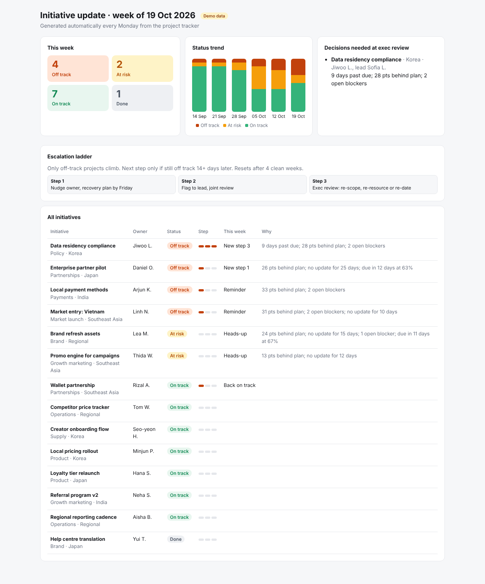

# Weekly initiative tracker with fair escalation

**[Open the live tracker →](https://theyvetteliu-commits.github.io/initiative-tracker/)** Filter by market or workstream, pick any week, and click a project to see its history and the nudge drafted for its owner.



**Context:** When many projects run at once across teams and markets, things stall quietly. Blockers surface late, rules for "when do we escalate" change with whoever is looking, and chasing owners eats the week.

* **What I did (and why):** I built a weekly pipeline that rates every project as on track, at risk, or off track, using the same written rules every time. Slipping projects get escalated in three steps: nudge the owner, then flag the lead, then raise it at exec review with a decision needed. Each step waits two weeks, so owners get a fair chance to recover before anything goes up. It writes the exec update and the owner nudges for me, and logs every step so any escalation can be traced.
* **Result:** I've used this way of working to run several multi-team launches, from a single new product to a whole new business line.

> This repo is a public demo. Every project, person and number in it is invented. It turns the way I run multi-team launches into a working tool.

## What it does every Monday

```
project snapshot (CSV export from your tracker or sheet)
        │
        ▼
 rate each project ──> escalate if needed (uses last week's history) ──> write outputs ──> Google Sheet
```

| Output | For whom |
|---|---|
| `index.html` + `site-data.json` | The interactive page: every week, filterable, click-through on every row. Rebuilt by `scripts/build_site.py` at the end of each run. |
| `out/<date>/report.html` | Leadership. One page: counts, trend, decisions needed, every project. |
| `out/<date>/exec_update.md` | The same update as text, ready to paste into email or Slack. |
| `out/<date>/owner_messages.csv` | Owners. One ready-to-send message each, matched to their step. |
| `out/<date>/this_week.csv` | Everyone. Every project with status, reasons, step and action. |
| `data/escalation-history.csv` | The escalation memory between weeks. |

## The rules

**Status**, worked out fresh every week:
- **Off track:** past due, or 25+ points behind plan, or no update for 21+ days, or 2+ open blockers.
- **At risk:** 10–25 points behind plan, or no update for 10+ days, or 1 open blocker, or due within 14 days and under 80% done.
- **On track:** none of the above.

**Escalation steps**, off-track projects only:

| Step | Action |
|---|---|
| 1 | Nudge the owner: recovery plan by Friday |
| 2 | Flag to the lead: owner and lead review it together |
| 3 | Exec review: re-scope, re-resource or re-date |

- The next step only comes if the project is still off track 14+ days after the last one. In between, the owner gets a weekly reminder.
- There is no step 4. Still off track after step 3 means it's back on the exec agenda every two weeks.
- At risk gets a heads-up, never a step.
- Escalation resets after four weeks with no off-track week.

## Design choices

- **Rules are pure functions** (`scripts/ladder.py`) with no file or network access, so they're tested on their own (`tests/test_ladder.py`).
- **Runs can't double-apply.** If a date already ran, the script stops unless forced, so a retried job can't push someone up two steps.
- **The history file holds IDs, steps and dates only.** Names and notes stay in the source tracker.
- **The sheet is optional.** Without Google credentials everything still runs and writes local files.

## Run it yourself

```bash
python scripts/make_demo_data.py          # six weeks of invented snapshots
for f in data/snapshots/*.csv; do
  python scripts/run_weekly.py --snapshot "$f" --date "$(basename "$f" .csv)" --no-sheet
done
python tests/test_ladder.py
python -m http.server 8000      # then open http://localhost:8000
```

To push to Google Sheets, add `GOOGLE_SERVICE_ACCOUNT_JSON` and `GOOGLE_SHEET_ID` as repository secrets and share the sheet with the service account.
